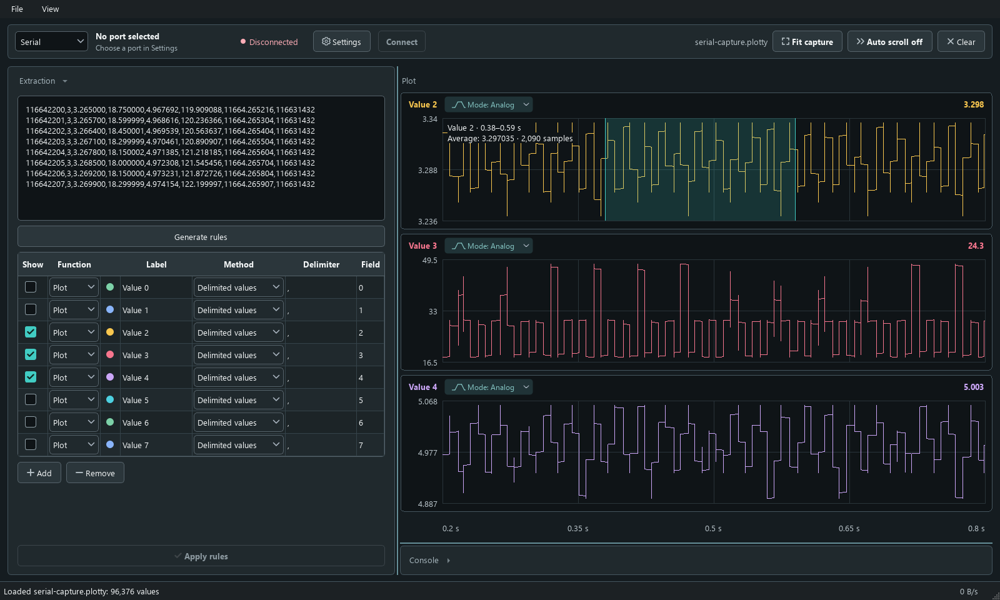

# PlotTTY

**Serial and J-Link RTT monitoring, plotting, and capture review.**

PlotTTY turns device text output into live plots. Inspect signals, measure averages
over selected ranges, and save recordings to revisit later.

[**Download PlotTTY**](https://github.com/krupis/QT_PlotTTY/releases/latest)
· [Get started](#get-started) · [Plot controls](#use-the-plots) · [Run from source](#run-from-source)

[](docs/images/plottty-capture.png)

*A recorded serial capture in PlotTTY. Click the image to view it at full size.*

| Feature | What you can do |
| --- | --- |
| Serial and J-Link RTT | Read device output and inspect incoming text in the console. |
| Flexible extraction | Generate rules from sample output, or use named values, delimited fields, first-number matching, and regex. |
| Live plots | Switch between Analog, Digital, and Dots; pan, zoom, and follow incoming samples. |
| Range measurements | Drag across a signal to see its average, time range, and sample count. |
| Record and review | Save console logs and `.plotty` captures, reopen captures, and export CSV. |

## Get started

Download the archive for your platform from the
[latest release](https://github.com/krupis/QT_PlotTTY/releases/latest) and extract it
before launching. Packaged releases include Python and the application dependencies.

| Platform | Package | Launch |
| --- | --- | --- |
| Windows x64 | `windows-x64.zip` | Run `PlotTTY.exe`; keep the `app/` folder and supporting files beside it. |
| macOS Apple silicon | `macos-arm64.zip` | Open `PlotTTY.app`. |
| macOS Intel | `macos-x64.zip` | Open `PlotTTY.app`. |
| Linux x64 | `linux-x64.tar.gz` | Run `./PlotTTY` from the extracted folder. |

1. Choose **Serial** or **J-Link RTT** in the connection bar.
2. Open **Settings**, configure your connection, then choose **Save settings**.
3. Enable **File → Log to file** if you want a permanent recording.
4. Click **Connect**. Open **View → Console** to see incoming text.
5. Paste a sample line into the extraction sidebar, click **Generate rules**,
   review the fields, then click **Apply rules** to start plotting.

For Serial, select a port and baud rate. Use **Rescan** if the port is missing.
Settings also include encoding and the line ending used when sending commands.

For RTT, install SEGGER's J-Link Software and Documentation Pack, make its library
available (`JLinkARM.dll` on Windows), and enter the target device in Settings.
Close other software using the probe before connecting.

## Extract values

Plots appear after extraction rules are applied. Use **Add** and **Remove** to
edit rules manually, or open an example from [profiles/](profiles/).

| Method | Use it for |
| --- | --- |
| Named values | Pairs such as `Voltage: 3.31, Current: 0.12`. Each name becomes a series. |
| Delimited values | CSV or similar output. Choose a delimiter and field: **0 is the first field**. |
| First number | The first numeric value on each line. |
| Regex pattern | Custom text formats. The first capture group supplies the numeric value. |

Choose **Plot** to create a series, or **Time** to read device timestamps in seconds.
Without a Time rule, PlotTTY uses receive times. With one, lines missing a valid
timestamp stay in the console but do not add plot samples.

Use **Show** to hide a series while it continues collecting data. Click a color
dot to change its color, or right-click it to restore automatic colors.
Click **Apply rules** after editing. Changes affect future samples.

## Use the plots

Use each signal's **Mode** selector: **Analog** connects samples, **Digital** holds
each value until the next sample, and **Dots** shows sample positions.
Modes affect display only.

| Control | Action |
| --- | --- |
| Left-drag across a signal | Select a time range and calculate its average on release. |
| Click the plot or press Escape | Clear the selection. |
| Shift + drag or middle-button drag | Pan time. Dragging the bottom time axis also pans. |
| Mouse wheel | Zoom time around the cursor. |
| Drag / wheel over the Y axis | Pan / zoom that signal's value range. |
| Double-click the Y axis | Reset its value range. |
| **Auto scroll** | Follow the newest samples. |
| **Fit capture** | Show the full captured time range. |

Hover over a signal to read cursor coordinates. The value in each plot header
is the latest captured value, even when viewing older history.

Selections show the time range, average, and sample count on the plot. Averages use
the original captured samples. Non-finite values are skipped. Selecting pauses
automatic time navigation while data collection continues.

Wide views reduce the number of points drawn. Zoom in for individual samples.
**View → Diagnostics** shows point counts and downsampling. **View → Raw point
limits** changes the downsampling thresholds for each mode.

## Console and layout

- **Ctrl+F** opens console search. Use **Previous** and **Next** to move through matches.
- Send a command with **Enter** or **Send**. **Up/Down** recalls sent commands.
- **View** shows or hides panels. Drag the dividers to resize them.
- The console's **Clear** clears text. The plot's **Clear** clears plotted data.
  **File → Clear captured data** clears both. Saved recordings are kept.

Console history is temporary and is deleted when the app closes. Search covers
the complete history. Selection and copying apply to the currently loaded text.
Window layout is remembered between launches.

## Profiles and recordings

- **File → Save profile / Open profile** saves and restores applied extraction
  rules, colors, and series visibility in a JSON file.
- **File → Log to file** records each connection to a console `.log` and a
  `.plotty` capture containing extracted values, timestamps, labels, and source text.
  Set this option before connecting. Disconnect to finish the recording.
- **File → Load capture** opens a saved `.plotty` file for review.
- **File → Export capture as CSV** exports a finished capture for other tools.
  CSV import is not supported.

Recordings go into `logs/` under the app's working directory. Hover over
**Log to file** for the full folder path, or the recording status for file paths.
Loading and exporting can be cancelled.

## Run from source

With Python 3.13 installed, run these commands from the project folder on Windows:

```powershell
python -m venv .venv
.venv\Scripts\python.exe -m pip install -r requirements.txt
.venv\Scripts\python.exe mainwindow.py
```

## License

[MIT License](LICENSE). See [THIRD_PARTY_NOTICES.txt](THIRD_PARTY_NOTICES.txt)
and the licenses included with packaged releases for dependency notices.
