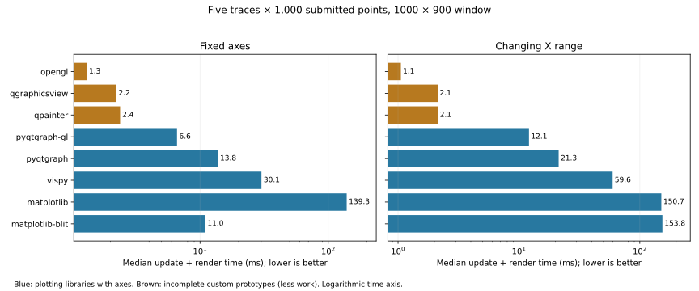

# Plot backend benchmark ? 2026-09-23

The best first change supported by this experiment is **trying pyqtgraph's
OpenGL viewport**, while retaining the existing widget and data pipeline.
It roughly halved renderer-only refresh cost at the normal display size and
reduced actual-widget refresh cost by 44%. Neither tested alternative plotting
library provided a better overall refresh-and-navigation result in this setup.

Custom QPainter, QGraphicsView, and OpenGL prototypes are substantially faster
at normal point counts, but do substantially less work. Their numbers are
lower bounds, not a promise that a complete replacement will achieve them.

No production plotting code, application requirements, or downsampling behavior
was changed. The optional packages live under `benchmarks/_deps`.

## Machine and methodology

Windows 11, Python 3.13.3, Qt/PySide6 6.11.1, pyqtgraph 0.14.0,
NumPy 2.5.1, Matplotlib 3.11.2, VisPy 0.17.0, PyOpenGL 3.1.10.
GPU: **NVIDIA GeForce GTX 1060 6GB**. Reported CPU identifier:
Intel64 Family 6 Model 158 Stepping 10. Native Windows Qt platform, device pixel
ratio 1.0, 1000 x 900 window, five stacked series. This is a single-machine result.

Times include updating all five curves and synchronous repaint/event processing.
GPU paths also wait for GPU completion. Each renderer case has 120 timed
iterations (three repeats of 40, each with ten warmups). Data generation is
outside the timed region; path/vertex conversion and uploads are inside it.
Refresh changes the data with fixed axes. Pan/zoom changes data and X ranges.
These are service times, not displayed FPS or measured mouse latency.
See [README.md](README.md) for the full method and limitations.

## Normal display workload

About 1,000 submitted points per series is representative of the current
pixel-sized reduction budget, even when millions of raw points are stored.

| Backend | Points per series | Refresh median / p95 (ms) | Pan/zoom median / p95 (ms) |
|---|---:|---:|---:|
| pyqtgraph | 1,000 | 13.78 / 16.37 | 21.32 / 23.74 |
| pyqtgraph-gl | 1,000 | 6.61 / 7.87 | 12.11 / 12.90 |
| matplotlib | 1,000 | 139.31 / 148.96 | 150.69 / 168.43 |
| matplotlib-blit | 1,000 | 10.98 / 11.99 | 153.82 / 171.29 |
| vispy | 1,000 | 30.13 / 32.37 | 59.61 / 63.35 |
| qpainter | 1,000 | 2.38 / 4.03 | 2.13 / 3.43 |
| qgraphicsview | 1,000 | 2.23 / 3.66 | 2.13 / 3.28 |
| opengl | 1,000 | 1.31 / 2.56 | 1.06 / 1.76 |

Full plotting libraries include axes, labels, titles, and grids. QPainter and
QGraphicsView include traces, fixed grids, titles, and clipping but no dynamic
tick labels or interaction. Raw OpenGL includes only clipped traces. Axis layouts
also differ between the complete libraries. Do not interpret the custom rows as
an equivalent-functionality ranking.

Matplotlib blitting helps when axes remain fixed, but its cached background must
be regenerated as the limits change. This is consistent with the
[Matplotlib blitting documentation](https://matplotlib.org/stable/users/explain/animations/blitting.html).
The reported VisPy result is for this five-panel scene with axes/grids and GL
lines, not a claim about every possible VisPy implementation.

## Actual PlotWidget with five million stored samples

The unmodified widget was tested with one million raw samples in each of five
series. Only the OpenGL configuration differs between workers. The normal timer
was stopped so refreshes could be measured synchronously. No incoming serial
stream or log writing ran concurrently. Each case has 40 timed iterations after
ten warmups and includes disk-backed lookup, summary selection, NumPy conversion,
curve submission, and repainting.

| Backend | Points per series | Refresh median / p95 (ms) | Pan/zoom median / p95 (ms) |
|---|---:|---:|---:|
| current-widget | 1,000,000 raw | 19.76 / 20.63 | 25.84 / 27.05 |
| current-widget-gl | 1,000,000 raw | 11.04 / 11.87 | 18.47 / 19.54 |

With all history visible, each series reduced to 400 plotted points. The
standalone read/downsample/array-conversion stage across all five series cost
**2.91 ms median / 3.66 ms p95** in the raster worker and **2.85 / 3.57 ms** in
the GL worker. These figures are cache-warm. Preloading synthetic samples took
about 20 seconds per worker and is not included in frame timings.

OpenGL saved about **8.7 ms per refresh (44%)** and **7.4 ms per range change
(29%)** here. Both modes fit within the existing 50 ms refresh interval under
this isolated workload; OpenGL provides additional headroom rather than proving
that the current backend cannot keep up. Concurrent ingestion, parsing, logging,
and user input still need an application-level trial before changing defaults.

## Larger submitted arrays

These are stress cases, not the number of vertices normally emitted by the
current reduction pipeline. The signal remains smooth with a fixed frequency
as point count increases; dense random noise could produce different raster costs.

| Backend | Points per series | Refresh median / p95 (ms) | Pan/zoom median / p95 (ms) |
|---|---:|---:|---:|
| pyqtgraph | 10,000 | 17.83 / 20.57 | 26.58 / 27.09 |
| pyqtgraph | 100,000 | 64.89 / 66.08 | 71.73 / 74.47 |
| pyqtgraph-gl | 10,000 | 7.00 / 7.92 | 12.34 / 12.97 |
| pyqtgraph-gl | 100,000 | 11.50 / 13.75 | 19.77 / 25.12 |
| matplotlib | 10,000 | 154.55 / 179.43 | 169.40 / 246.74 |
| matplotlib | 100,000 | 246.99 / 266.41 | 255.53 / 315.24 |
| matplotlib-blit | 10,000 | 21.73 / 23.89 | 165.95 / 202.90 |
| matplotlib-blit | 100,000 | 114.35 / 118.65 | 242.47 / 254.94 |
| vispy | 10,000 | 33.72 / 36.12 | 58.96 / 63.01 |
| vispy | 100,000 | 38.85 / 41.38 | 64.95 / 69.97 |
| qpainter | 10,000 | 5.86 / 7.30 | 5.63 / 6.91 |
| qpainter | 100,000 | 32.33 / 33.67 | 31.55 / 33.18 |
| qgraphicsview | 10,000 | 5.02 / 6.15 | 5.07 / 6.58 |
| qgraphicsview | 100,000 | 32.20 / 34.59 | 31.86 / 34.00 |
| opengl | 10,000 | 1.44 / 2.26 | 1.81 / 2.62 |
| opengl | 100,000 | 13.53 / 15.30 | 13.71 / 17.00 |

At 100,000 points per series, pyqtgraph's GL path was actually faster than the
raw GL prototype for fixed-axis updates (11.50 versus 13.53 ms). Direct GPU
primitives are not automatically faster: data conversion and buffer handling
matter too. The raw prototype performs CPU coordinate conversion and allocates
and uploads fresh vertices on each update.

## How difficult would replacement be?

| Option | Integration scope | Assessment |
|---|---|---|
| pyqtgraph OpenGL | Small configuration change; same PlotWidget and interactions | Best first experiment; strongest gain for least work |
| Matplotlib | Embed Qt canvas; adapt curves, axes, navigation, synchronization, and refresh behavior | Feasible, but measured navigation performance argues against it |
| VisPy | Embed native Qt canvas; adapt scene/axes, camera events, Y auto-range, and linked navigation | Feasible; this implementation did not beat pyqtgraph |
| Custom QPainter | Keep QWidget wrapper and storage; implement axes, ticks, transforms, mouse navigation, Y modes, and resize handling | Promising for a deliberately limited plotting feature set; substantial implementation work |
| Custom QGraphicsView | Similar to QPainter, using scene items | Little measured advantage over QPainter; pyqtgraph already uses QGraphicsView |
| Raw OpenGL | Build the plotting features plus GPU buffers/shaders, clipping, context lifetime, and device testing | Most engineering and portability work; unjustified as the first step for about 1,000 displayed points |

The external interface is small: `mainwindow.py` uses `append_values`,
`clear_values`, and `show_all_data`, and the UI instantiates `PlotWidget`.
Those can remain unchanged. Internally, backend-specific operations are spread
through plot creation, range synchronization, data submission, Y scaling, and
viewport-width lookup. A renderer adapter would make experiments easier while
preserving the toolbar, `Plotter`/`Buckets`, extraction, and serial logic.
The proposed adapter contract is in [README.md](README.md#replacement-boundary).

The simplest next implementation would be an optional OpenGL setting on the
existing graph, with raster mode still available. A broader backend adapter is
worth doing if a custom plot is still desirable after testing that option.
This report recommends that sequence; it does not silently enable it.

## Artifacts and validation

- [Rerunnable benchmark](plot_backends.py), [instructions](README.md), and
  [pinned optional dependencies](requirements.txt).
- [Machine-readable measured summary](measurements.json) and
  [chart](comparison.svg).
- Full timing samples, screenshots, and logs are in `results/full/` locally
  (ignored by Git). Initial smoke checks are in `results/smoke/` and `results/check/`.
- All ten implementations/cases completed. Representative renderer screenshots were inspected,
  including direct framebuffer captures for the GPU paths. The code was compiled
  with `py_compile`; JSON timing sample counts and percentile ordering were checked.

These exploratory measurements have no randomized execution order or confidence
intervals. They do not measure peak memory, sustained acquisition, or portability
to other GPUs. Line styles and axis layouts are not identical across libraries.
Small differences, particularly between the two custom Qt prototypes, should not
be treated as evidence for a migration.
